<h1 align="center">
  
</h1>

<p align="center">
  Rich Presence, RetroAchievements and save backups for DS games running on actual hardware.
</p>

<p align="center">
  <a href="https://github.com/VampyreVK/DSiRPC/releases/latest"></a>
  
  
  <a href="LICENSE"></a>
</p>

Pick up your DSi, start a game, and your friends see what you're up to: the
route you're exploring, the Pokémon in your party, the Gym Leader you're
facing. DSiRPC reads the game's memory on the console itself and sends it to
your PC over Wi-Fi, which turns it into your Discord status, a stream
overlay and achievement unlocks. No emulator, no capture card: just your
console and your PC.

<p align="center">
  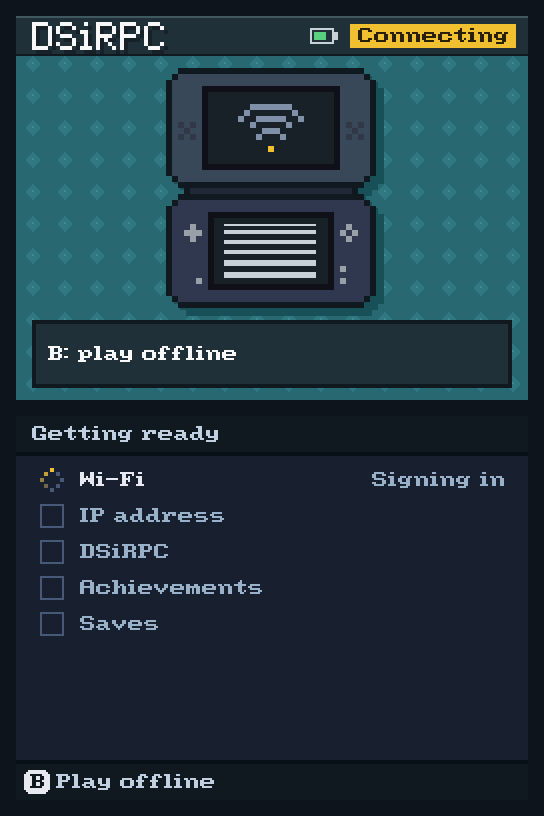
</p>
<p align="center"><sub>The launcher in motion, drawn by its own code for the latest release. <a href="https://raw.githubusercontent.com/VampyreVK/DSiRPC/renders/demo.mp4">The video, with its music</a> (MP4).</sub></p>

## &nbsp;Features

- **A live Discord status for any DS game:** its name, box art and your
  console, plus what you're doing in it when RetroAchievements has a rich
  presence for it ("Racing in Figure-8 Circuit").
- **The full treatment for Pokémon Platinum, Black and White:** where you
  are, your party, badges and Pokédex, and who you're battling, with animated
  sprites set on the right terrain.
- **Tetris DS, live:** the board as you play it, your stored block, score,
  lines and level, in the overlay and on Discord.
- **RetroAchievements on real hardware:** achievements are checked while you
  play, by your PC and by the console itself. They show up in a menu in-game on the
  console (L + Down + B), pulse a DSi LED when you have a new unlock, and can go straight to your RetroAchievements profile if you choose.
- **Play anywhere:** away from your Wi-Fi, the console keeps checking
  achievements and hands them over the next time it sees your PC. A
  hotspot that drops out for a few seconds doesn't lose it either.
- **Save backups and sync:** one button backs up every save to your PC,
  keeps the last 10 versions from each console, and carries your progress
  between your DSi and 3DS.
- **A launcher that looks the part:** your games with their own icons,
  sorted by when you last played them, with your favorites first or by the
  achievements you've unlocked, each
  game's achievements and DSiRPC playtime (offline play counts too), the
  battery, soft menu sounds, menu music (Bright or Subtle) and the touch
  screen. The original text screens are one setting away.
- **A stream overlay:** a crisp pixel-art window with your party, battles in
  the games' own style and achievement banners, ready for OBS, with the
  launcher's music if you'd like it.
- **Updates itself, console included:** DSiRPC finds a new release on its
  own and installs it from its menu, and the launcher then takes the new
  console files from it over Wi-Fi, without taking the SD card out.
- **Quick to set up:** one download with everything included, a few setup
  questions, and an icon by the clock (or in the menu bar on a Mac) that
  tells you what it sees.

## &nbsp;What you need

- A **DSi or 3DS** with [TWiLight Menu++](https://github.com/DS-Homebrew/TWiLightMenu)
  installed, and your games as `.nds` files on its SD card.
- The console's **Wi-Fi** set up for the same network as your PC (on a DSi,
  a WPA2 network goes in connection 4, 5 or 6).
- A **Windows 10 or 11 PC** (64-bit) or a **Mac with Apple silicon** (macOS
  12 or newer), with the **Discord** desktop app.

## &nbsp;Get started

1. **Download** `DSiRPC-<version>-windows.zip` (or `-macos.zip`) from the
   [latest release](https://github.com/VampyreVK/DSiRPC/releases/latest).
2. **Set up the PC.**
   - Windows: unzip it somewhere you can write to (like Documents), then
     double-click `Setup.bat` and answer its questions. Then double-click
     `DSiRPC.bat`, and allow it on **private networks** when Windows asks.
   - Mac: drag **DSiRPC.app** into Applications and open it with
     right-click > **Open** the first time. Setup opens by itself. Allow it
     on the **local network** when macOS asks.
3. **3DS/DSi:** copy the entire `DSiRPC` folder from the zip's `SD card`
   folder to `/roms/nds` on your console's SD card.
4. **Play:** on the console, open the `DSiRPC` folder in `roms/nds` from
   TWiLight Menu++ and start `dsirpc-launcher.nds`. Once it connects, open
   **Games** and pick one (next time, **START** starts the last one).

Within about 15 seconds, Discord shows what you're playing. The zip's
`README.txt` walks through each step, and the
[user guide](docs/USER_GUIDE.md) covers everything else.

## &nbsp;The launcher

<p align="center">
  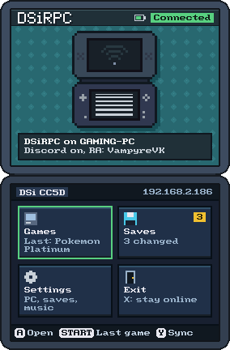
  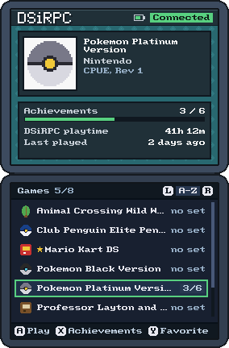
  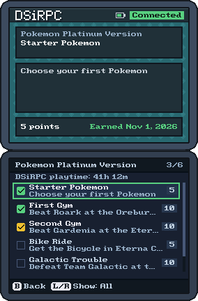
  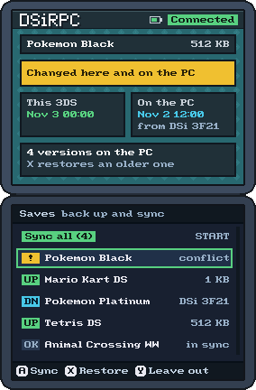
</p>
<p align="center"><sub>The launcher on your console: the main screen, your games, a game's achievements and the save sync.</sub></p>

Pick a tile with the D-pad and **A**, or tap it. The bottom of the screen
always shows the buttons that work where you are, so these are just the
shortcuts worth knowing:

| Where | Press | To |
|---|---|---|
| While it connects | **B** | Skip connecting and play offline |
| Main screen | **START** | Start the game you played last |
| Main screen | **Y** | Sync your saves (the **Saves** tile) |
| Main screen | **L + R** | Open the settings (the **Settings** tile) |
| Main screen | **SELECT** | Leave the launcher (**X** leaves it still connected) |
| Game list | **X** / **Y** | See the game's achievements / make it a favorite |
| Game list | **L** / **R** | Sort by last played, A to Z, favorites first, or most unlocked first |

In the classic look, **START** opens a file browser instead, where
**START** starts the last game.

### In a game

Press **L + Down + B** in a game for the in-game menu, in the launcher's
look. Besides going back to the game, resetting it and the rest of
nds-bootstrap's menu, it lists the game's achievements, with any new
unlocks up top. The Wi-Fi sign at its top left is green while DSiRPC is
talking to the console, yellow while it isn't (or the console is still
connecting), red if the Wi-Fi failed, and gray if DSiRPC isn't running.

<p align="center">
  
</p>
<p align="center"><sub>The in-game menu, drawn by its own code: the main menu, a game's achievements and the options.</sub></p>

## &nbsp;Offline RetroAchievements

The console checks your achievements itself, so they unlock wherever you
play: on the couch next to your PC, on a train, or with the Wi-Fi off.

- **Every achievement the console can do:** a game started from the launcher
  gets its achievement set, and the console checks the achievements you
  haven't earned yet, all of them in the sets tested so far. The few it
  can't are ones that need decimal math, which DSiRPC checks when it's
  watching.
- **The right set for your copy:** the first time the launcher sees a game,
  it works out the game file's RetroAchievements hash (a moment for each
  game, once), so DSiRPC picks the set for that exact version, every game
  with a set gets it at the next sync, and the launcher marks the ones
  RetroAchievements has no set for (by their file's name, so a ROM hack
  isn't called by the game it's based on).
- **Every frame where it counts:** an achievement that hangs on a single
  frame (a T-Spin, a one-frame flag, a hit count) is checked on every frame
  the game draws, even when the game is busy. The rest are checked many
  times a second.
- **Games run at their usual speed:** the checking runs in the time the
  console's second processor would otherwise spend waiting.
- **See them right away:** the in-game menu (**L + Down + B**) shows your new
  unlocks up top and lists every achievement, earned ones first, with when
  you earned them.
- **A light when you unlock one:** on a DSi, the LED you picked for
  TWiLight Menu++'s **ROM read LED** setting (Wi-Fi, power in purple, or
  camera) pulses after a new unlock until you open the in-game menu.
- **Handed over at the next sync:** unlocks are saved to the SD card as they
  happen. The next time the launcher sees DSiRPC, they go to your PC, and to
  your RetroAchievements profile if you turned that on.
- **It gets better as you play:** the console notices which achievements
  really need checking every frame and tells DSiRPC, which builds the
  game's next set around that.

<p align="center">
  
</p>
<p align="center"><sub>Two new unlocks in the in-game menu, then the game's list: drawn by the menu's own code.</sub></p>

**How it works, briefly.** DSiRPC has
[rcheevos](https://github.com/RetroAchievements/rcheevos), the engine
emulators use, read each game's achievements, and turns what it read into
a compact program for the console. The launcher copies it to the SD card.
In the game, DSiRPC's nds-bootstrap runs that program on the console's
second processor (the ARM7) with a port of rcheevos' rules, so it unlocks
exactly what rcheevos would. Achievements that need every frame go in a
*frame lane*: their memory is read at the start of every frame into a
buffer of up to 256 frames (about 4 seconds), and checked in order as time
allows, so a busy moment never skips one. The rest go in a *pass lane*,
checked again and again. An achievement whose memory hasn't changed is
skipped. A *shadow check* runs the frame lane a second time, the way the
pass lane would, and notes for DSiRPC any achievement that came out
differently: proof that it needs the frame lane. All the details are in
[docs/OFFLINE_ACHIEVEMENTS.md](docs/OFFLINE_ACHIEVEMENTS.md).

## &nbsp;Pokémon, in full

Pokémon Platinum (USA, Rev 1) and Black and White (USA) get much more than a
status. DSiRPC reads your party, your trainer and every battle as you play,
so your Discord status and the desktop app's overlay window always show
the real thing.

<p align="center">
  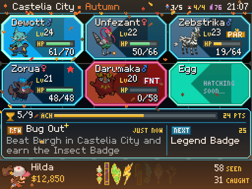
  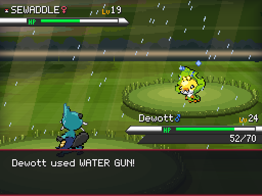
  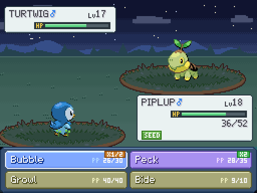
</p>
<p align="center"><sub>The desktop app's overlay window, drawn by its own code from its demo for the latest release: Pokémon Black, a battle in Black's Pinwheel Forest, and Platinum's rival at night.</sub></p>

- **On Discord:** where you are ("Exploring Route 209", or running, biking
  and surfing through Unova), your badges and Pokédex, how many of your
  party can still fight, your trainer walking the way you face, and your
  lead Pokémon. In a battle, who you're up against (a wild or shiny
  Pokémon, a trainer, a Gym Leader, the Elite Four, the Champion, or your
  rival by the name you gave them), with the foe's sprite and both sides'
  HP. The timer is your save's playtime.
- **In the overlay window:** your party with animated sprites, HP bars that
  slide, status and shinies, and your trainer walking along with your
  badges and Pokédex. **V** opens the party screen: every Pokémon's moves
  and PP, its nature and its held item.
- **Battles in each game's own style:** the backdrop follows the place, the
  time of day and the weather (rain, snow, sandstorms, fog), the Pokémon
  slide in, and every move plays an animation in its type's colors, from
  punches and bites to Surf rolling across the field.
- **Black and White's extras:** the season and the in-game clock, the
  trainers you've beaten and items you've found on each route, the steps
  left on a Repel, your Battle Subway streak, Battle Institute rank and
  Elite Four progress, and every Gym Leader, Elite Four member and the
  Champion by name.
- **The big moments:** new badges, catches, level-ups and shiny encounters
  get a banner, and so do achievements, with your progress, the latest
  unlock and the next one to earn on the main view.

## &nbsp;Other integrations

Beyond Pokémon, DSiRPC reads a game's own memory when it knows its layout,
and every other game still gets a card of its own.

<p align="center">
  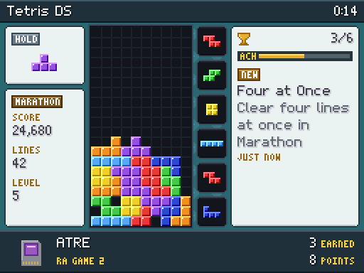
  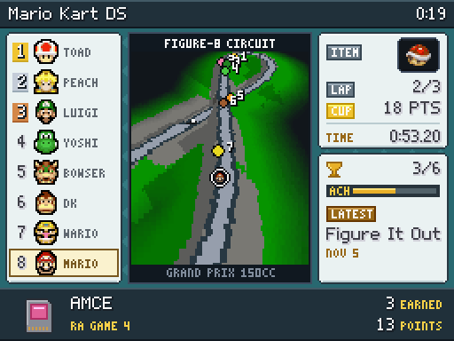
  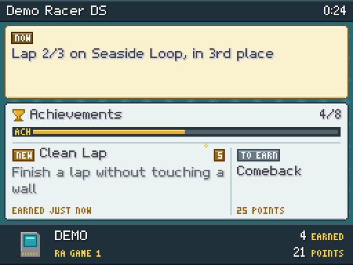
</p>
<p align="center"><sub>The overlay window with Tetris DS (a Tetris, on a loop), a Mario Kart DS race, and the card every other game gets.</sub></p>

- **Tetris DS (USA):** in Marathon, Line Clear, VS CPU and Mission the overlay shows
  the board as you play it, the falling piece and where it'll land, your
  stored block, the next six pieces, and your score, lines (lines left in
  Line Clear) and level, with the achievements beside it and a banner for
  every Tetris and new level. Discord shows the
  mode and level, then the score, lines and the block you're holding
  ("Marathon · Level 5", "Score 24,680 · 42 lines · Holding Z"). The menus
  and the other modes get the game card.
- **Mario Kart DS (USA):** in Grand Prix, VS and Time Trial races the overlay
  shows the racers in order, reshuffling as they pass each other, and the
  whole course as voxel terrain, circled by a broadcast camera, with
  everyone on it at their real height (under the bridges and all). Beside them
  are the item you're holding, your lap and the race's time (your points in
  the cup in a Grand Prix), with the achievements below and a banner for the
  final lap and the finish. Battle, Missions and the menus get the game card,
  and Discord keeps the game's rich presence.
- **Any other game:** its name, box art and your console on Discord, plus
  what you're doing in it when RetroAchievements has a rich presence for it.
  The overlay's card shows the same, with your achievements: progress, the
  latest unlock and the next one to earn.

## &nbsp;Good to know

- Pokémon Platinum (USA, Rev 1) and Black and White (USA) get the full
  presence, Tetris DS (USA) its board; every other game gets its name, box
  art and rich presence.
- **Wi-Fi hiccups:** a network that drops out for a few seconds (a phone's
  hotspot, say) is usually ridden out: the overlay shows a small Wi-Fi sign
  meanwhile, and DSiRPC picks up again the moment the console's back. After
  a longer outage, start the game from the launcher again to reconnect.
- **Closing the lid (DSi):** a DSi can't sleep with its Wi-Fi on, so by
  default closing the lid ends the Wi-Fi for that game. With the launcher's
  **Lid closed: Stay connected**, it pauses the game instead and stays
  connected, at the cost of some battery. A 3DS sleeps either way.
- **Achievements away from your PC:** the console checks almost every
  achievement on its own, but a few only unlock while DSiRPC is watching
  (near your PC): ones that need decimal math, which the console's second
  processor can't do, and, in a very big set, the biggest ones if the whole
  set doesn't fit in the memory the console keeps for it. Ones that read
  memory the DSi can't reach (the ARM9's own fast RAM) don't unlock with
  DSiRPC at all, and ones about split-second moments can unlock late.
- Sending your unlocks to RetroAchievements is up to you (off unless you
  turn it on in setup), and always softcore: RetroAchievements doesn't
  officially support original hardware.
- While a game runs through DSiRPC, the console's Wi-Fi is DSiRPC's, so the
  game's own Wi-Fi features don't work, and DSi-enhanced games run in DS mode.

**Something not working?** Right-click DSiRPC's icon by the clock: the first
lines of its menu say what it sees. The usual fixes (the firewall, the
network, the launcher's settings) are in the user guide's
[troubleshooting](docs/USER_GUIDE.md#troubleshooting).

## &nbsp;How it works

```
Console                                          PC
dsirpc-launcher.nds   <--- sync, port 4245 --->  DSiRPC
  connects to Wi-Fi,                             sends sets, takes offline
  starts the game                                unlocks, backs up saves,
                                                 updates the console's files
        |
        v
DSiRPC's nds-bootstrap --boots--> the game
  memory server and                              reads the game's state,
  achievement checker  <------ UDP 4244 ------>  checks achievements
  (in the ARM7)                                    |                |
                                                   v                v
                                           Discord presence   overlay window
```

The console only answers "give me these bytes" and, for offline play, runs
the achievement program the PC prepares for it. Everything else, from
decoding your party to deciding what Discord shows, happens on the PC. The
console's part runs in the time the game's second processor leaves free, so
games run at their usual speed.

## &nbsp;For developers

| Where | What |
|---|---|
| [docs/USER_GUIDE.md](docs/USER_GUIDE.md) | Everything about using DSiRPC, in detail |
| [docs/DEVELOPMENT.md](docs/DEVELOPMENT.md) | Running from the source code, building the console files, the command line and testing flags, tools, tests and releases |
| [docs/DOCUMENTATION.md](docs/DOCUMENTATION.md) | The technical reference: the protocol, the achievement checker, the memory maps, troubleshooting |
| [docs/OFFLINE_ACHIEVEMENTS.md](docs/OFFLINE_ACHIEVEMENTS.md) | Offline achievements end to end: building the sets, the two lanes, the console's checker, learning what needs every frame, the unlocks' way back |
| [launcher/README.md](launcher/README.md), [nds-bootstrap/DSIRPC_CHANGES.md](nds-bootstrap/DSIRPC_CHANGES.md) | The console side: the launcher, and what was changed in nds-bootstrap |
| [tests/README.md](tests/README.md) | The tests GitHub runs on every change |
| [docs/HISTORY.md](docs/HISTORY.md) | How the project got here |

The PC side is Python (`app/`, `core/`, `overlay/`, `rpc/`); the console side
is a modified nds-bootstrap (GPLv3) and the launcher, built with BlocksDS.

## &nbsp;Roadmap

- [ ] Full presence for more games and versions, and ordinary trainers' names in Black and White's battles.
- [ ] Tetris DS's Push, Catch, Puzzle and Touch modes in the overlay.
- [ ] Location artwork for the large Discord RPC image in Pokemon games, and more overworld states (running, biking, surfing) in Platinum. Leads are in [docs/research.md](docs/research.md).
- [ ] More for the overlay: encounter and shiny counters, a Nuzlocke mode, browser-source panels for OBS.
- [ ] Handle WPA2 group-key renewal in game, if a router ever disconnects the console on a schedule. (Likely too large a change)

## &nbsp;Credits

- Pokémon sprites from [PokeAPI](https://pokeapi.co/)
  ([sprites repository](https://github.com/PokeAPI/sprites)).
- More sprites from [spriters-resource.com](https://www.spriters-resource.com/ds_dsi/pokemonblackwhite/).
- Overworld assets by [PurpleZaffre](https://eeveeexpo.com/threads/3667/).
- [nds-bootstrap](https://github.com/DS-Homebrew/nds-bootstrap) by DS-Homebrew
  (GPLv3), which hosts the in-game side.
- [BlocksDS](https://github.com/blocksds/sdk) and DSWiFi (MIT) for the launcher
  and the DSi-mode Wi-Fi code; devkitPro's
  [nds-bootloader](https://github.com/devkitPro/nds-bootloader) and
  [NDS Homebrew Menu](https://github.com/devkitPro/nds-hb-menu)'s bootstub
  (GPLv2+) for starting the game from it.
- [pret/pokeplatinum](https://github.com/pret/pokeplatinum) for struct
  layouts, the save layout and the name tables.
- [RetroAchievements](https://retroachievements.org/) code notes (Pokémon
  Platinum, game 11732, and Tetris DS, game 9878, by Brylefi) and
  [ProjectPokemon](https://projectpokemon.org/)'s notable breakpoints for
  memory addresses.
- [pypresence](https://github.com/qwertyquerty/pypresence) for Discord IPC,
  [pystray](https://github.com/moses-palmer/pystray) for the tray icon,
  [pygame-ce](https://github.com/pygame-community/pygame-ce) for the overlay.
- [rcheevos](https://github.com/RetroAchievements/rcheevos) (MIT) and
  RetroAchievements' set authors for other games' rich presence;
  [GameTDB](https://www.gametdb.com/) for box art and game titles.
- [The Spriters Resource](https://www.spriters-resource.com/ds_dsi/mariokartds/) for Mario Kart DS Assets

## &nbsp;License

DSiRPC's own code is MIT licensed (see [LICENSE](LICENSE)). The
`nds-bootstrap/` folder is GPLv3 (see [nds-bootstrap/LICENSE](nds-bootstrap/LICENSE)).
`launcher/loader/` (devkitPro's nds-bootloader and NDS Homebrew Menu's
bootstub) is GPLv2 or later, and so is the built `dsirpc-launcher.nds`,
which includes it. The Windows download's `licenses` folder lists everything
it bundles.

Pokémon is © Nintendo / Creatures Inc. / GAME FREAK inc., and Tetris is a
trademark of The Tetris Company. This is an unofficial fan project and isn't
affiliated with or endorsed by them.
