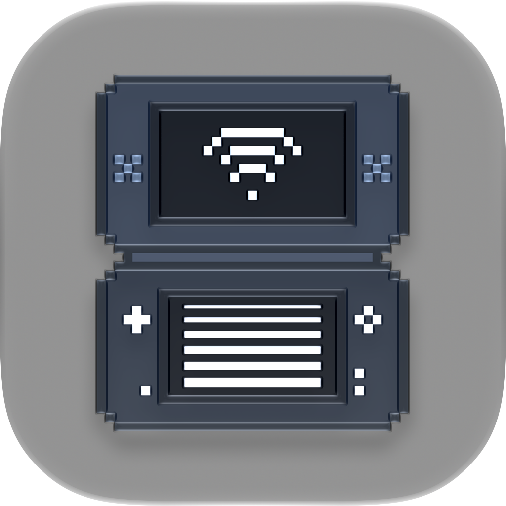
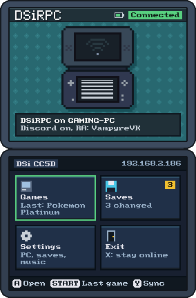
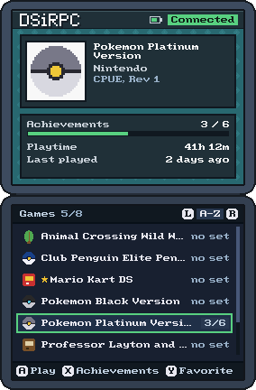
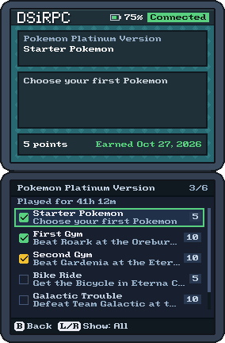
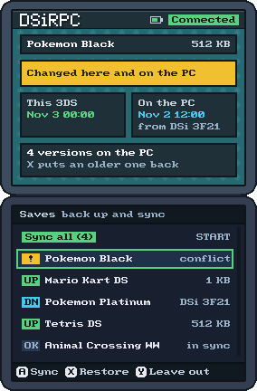

<p align="center">
  
</p>

<h1 align="center">DSiRPC</h1>

<p align="center">
  <b>Your real Nintendo DSi or 3DS, live on Discord.</b><br>
  Rich Presence, RetroAchievements and save backups for the DS games you play on actual hardware.
</p>

<p align="center">
  <a href="https://github.com/VampyreVK/DSiRPC/releases/latest"></a>
  
  
  <a href="LICENSE"></a>
</p>

Pick up your DSi, start a game, and your friends see what you're up to: the
route you're exploring, the Pokémon in your party, the Gym Leader you're
facing. DSiRPC reads the game's memory on the console itself and sends it to
your PC over Wi-Fi, which turns it into your Discord status, a stream
overlay and achievement unlocks. No emulator, no capture card: just your
console and your PC.

<p align="center">
  
  
  
  
</p>
<p align="center"><sub>The launcher on your console: the main screen, your games, a game's achievements and the save sync.</sub></p>

## Features

- **A live Discord status for any DS game:** its name, box art and your
  console, plus what you're doing in it when RetroAchievements has a rich
  presence for it ("Racing in Figure-8 Circuit").
- **The full treatment for Pokémon Platinum, Black and White:** where you
  are, your party, badges and Pokédex, and who you're battling, with animated
  sprites set on the right terrain.
- **RetroAchievements on real hardware:** achievements are checked while you
  play, by your PC and by the console itself. They show up in a menu on the
  console, and can go to your RetroAchievements profile if you choose.
- **Play anywhere:** away from your Wi-Fi, the console keeps checking
  achievements and hands them over the next time it sees your PC.
- **Save backups and sync:** one button backs up every save to your PC,
  keeps the last 10 versions from each console, and carries your progress
  between your DSi and 3DS.
- **A launcher that looks the part:** your games with their own icons,
  sorted by when you last played them or with your favorites first, each
  game's achievements and playtime, the battery, soft menu sounds, menu
  music (Bright or Subtle) and the touch screen. The original text screens
  are one setting away.
- **A stream overlay:** a crisp pixel-art window with your party, battles in
  the games' own style and achievement banners, ready for OBS.
- **Updates over Wi-Fi:** new versions reach the console without taking the
  SD card out.
- **Quick to set up:** one download with everything included, a few setup
  questions, and an icon by the clock (or in the menu bar on a Mac) that
  tells you what it sees.

## What you need

- A **DSi or 3DS** with [TWiLight Menu++](https://github.com/DS-Homebrew/TWiLightMenu)
  installed, and your games as `.nds` files on its SD card.
- The console's **Wi-Fi** set up for the same network as your PC (on a DSi,
  a WPA2 network goes in connection 4, 5 or 6).
- A **Windows 10 or 11 PC** (64-bit) or a **Mac with Apple silicon** (macOS
  12 or newer), with the **Discord** desktop app.

## Get started

1. **Download** `DSiRPC-<version>-windows.zip` (or `-macos.zip`) from the
   [latest release](https://github.com/VampyreVK/DSiRPC/releases/latest).
2. **Set up the PC.**
   - Windows: unzip it somewhere you can write to (like Documents), then
     double-click `Setup.bat` and answer its questions. Then double-click
     `DSiRPC.bat`, and allow it on **private networks** when Windows asks.
   - Mac: drag **DSiRPC.app** into Applications and open it with
     right-click > **Open** the first time. Setup opens by itself. Allow it
     on the **local network** when macOS asks.
3. **Set up the SD card:** copy the `DSiRPC` folder from the zip's `SD card`
   folder to the root of your SD card.
4. **Play:** on the console, open `DSiRPC/dsirpc-launcher.nds` from TWiLight
   Menu++, press **START** and pick a game.

Within about 15 seconds, Discord shows what you're playing. The zip's
`README.txt` walks through each step, and the
[user guide](docs/USER_GUIDE.md) covers everything else.

## The launcher

| Button | What it does |
|---|---|
| **A** (or a tap) | Open a tile: **Play** (pick a game, and start it still connected), **Saves**, **Settings** or **Exit** |
| **START** | Start the last game you played |
| **Y** | Back up your saves, and take newer ones from your other console |
| **L + R** | Settings: how to find your PC, the save mode, updates, the look, sounds and music |
| **SELECT** / **X** | Leave the launcher (**X** stays connected) |
| **B** while it connects | Play offline |

In the game list, **A** starts the game, **X** shows its achievements, **Y**
makes it a favorite and **L** / **R** change the order. (In the classic
look, **START** opens a file browser instead, where **START** starts the
last game.)

## Good to know

- Pokémon Platinum (USA, Rev 1) and Black and White (USA) get the full
  presence; every other game gets its name, box art and rich presence.
- Sending your unlocks to RetroAchievements is up to you (off unless you
  turn it on in setup), and always softcore: RetroAchievements doesn't
  officially support original hardware.
- While a game runs through DSiRPC, the console's Wi-Fi is DSiRPC's, so the
  game's own Wi-Fi features don't work, and DSi-enhanced games run in DS mode.

**Something not working?** Right-click DSiRPC's icon by the clock: the first
lines of its menu say what it sees. The usual fixes (the firewall, the
network, the launcher's settings) are in the user guide's
[troubleshooting](docs/USER_GUIDE.md#troubleshooting).

## How it works

```
Console                                          PC
dsirpc-launcher.nds   <--- sync, port 4245 --->  DSiRPC
  connects to Wi-Fi,                             sends sets, takes offline
  starts the game                                unlocks, backs up saves,
                                                 updates the console's files
        |
        v
DSiRPC's nds-bootstrap --boots--> the game
  memory server and                              reads the game's state,
  achievement checker  <------ UDP 4244 ------>  checks achievements
  (in the ARM7)                                    |                |
                                                   v                v
                                           Discord presence   overlay window
```

The console only answers "give me these bytes" and, for offline play, runs
the achievement program the PC prepares for it. Everything else, from
decoding your party to deciding what Discord shows, happens on the PC. The
console's part runs in the time the game's second processor leaves free, so
games run at their usual speed.

## For developers

| Where | What |
|---|---|
| [docs/USER_GUIDE.md](docs/USER_GUIDE.md) | Everything about using DSiRPC, in detail |
| [docs/DEVELOPMENT.md](docs/DEVELOPMENT.md) | Running from the source code, building the console files, the command line and testing flags, tools, tests and releases |
| [docs/DOCUMENTATION.md](docs/DOCUMENTATION.md) | The technical reference: the protocol, the achievement checker, the memory maps, troubleshooting |
| [launcher/README.md](launcher/README.md), [nds-bootstrap/DSIRPC_CHANGES.md](nds-bootstrap/DSIRPC_CHANGES.md) | The console side: the launcher, and what was changed in nds-bootstrap |
| [tests/README.md](tests/README.md) | The tests GitHub runs on every change |
| [docs/HISTORY.md](docs/HISTORY.md) | How the project got here |

The PC side is Python (`app/`, `core/`, `overlay/`, `rpc/`); the console side
is a modified nds-bootstrap (GPLv3) and the launcher, built with BlocksDS.

## Roadmap

- [ ] Full presence for more games and versions, and ordinary trainers'
      names in Black and White's battles.
- [ ] Location artwork for the big image, and more overworld states (running,
      biking, surfing). Leads are in [docs/research.md](docs/research.md).
- [ ] More for the overlay: encounter and shiny counters, a Nuzlocke mode,
      browser-source panels for OBS.
- [ ] Handle WPA2 group-key renewal in game, if a router ever disconnects
      the console on a schedule.

## Credits

- Pokémon sprites from [PokeAPI](https://pokeapi.co/)
  ([sprites repository](https://github.com/PokeAPI/sprites)).
- More sprites from [spriters-resource.com](https://www.spriters-resource.com/ds_dsi/pokemonblackwhite/).
- Overworld assets by [PurpleZaffre](https://eeveeexpo.com/threads/3667/).
- [nds-bootstrap](https://github.com/DS-Homebrew/nds-bootstrap) by DS-Homebrew
  (GPLv3), which hosts the in-game side.
- [BlocksDS](https://github.com/blocksds/sdk) and DSWiFi (MIT) for the launcher
  and the DSi-mode Wi-Fi code; devkitPro's
  [nds-bootloader](https://github.com/devkitPro/nds-bootloader) and
  [NDS Homebrew Menu](https://github.com/devkitPro/nds-hb-menu)'s bootstub
  (GPLv2+) for starting the game from it.
- [pret/pokeplatinum](https://github.com/pret/pokeplatinum) for struct
  layouts, the save layout and the name tables.
- [RetroAchievements](https://retroachievements.org/) code notes (game 11732)
  and [ProjectPokemon](https://projectpokemon.org/)'s notable breakpoints for
  memory addresses.
- [pypresence](https://github.com/qwertyquerty/pypresence) for Discord IPC,
  [pystray](https://github.com/moses-palmer/pystray) for the tray icon,
  [pygame-ce](https://github.com/pygame-community/pygame-ce) for the overlay.
- [rcheevos](https://github.com/RetroAchievements/rcheevos) (MIT) and
  RetroAchievements' set authors for other games' rich presence;
  [GameTDB](https://www.gametdb.com/) for box art and game titles.

## License

DSiRPC's own code is MIT licensed (see [LICENSE](LICENSE)). The
`nds-bootstrap/` folder is GPLv3 (see [nds-bootstrap/LICENSE](nds-bootstrap/LICENSE)).
`launcher/loader/` (devkitPro's nds-bootloader and NDS Homebrew Menu's
bootstub) is GPLv2 or later, and so is the built `dsirpc-launcher.nds`,
which includes it. The Windows download's `licenses` folder lists everything
it bundles.

Pokémon is © Nintendo / Creatures Inc. / GAME FREAK inc. This is an
unofficial fan project and isn't affiliated with or endorsed by them.
